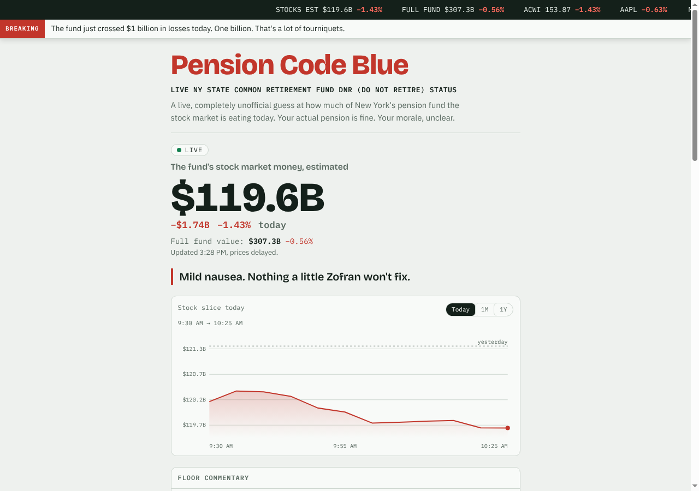

# Pension Code Blue

**Live NY State Common Retirement Fund DNR (Do Not Retire) Status**

A live, completely unofficial guess at how much of New York's pension fund the stock market is eating today. Built for a few medics who wanted something to stare at on red days between calls.

**Live site:** https://pension.poweredbyghosts.com/

> Your actual pension is fine. Your morale, unclear.

## What it does

- Estimates the stock slice of the fund (~$122B) in near real time, plus the full fund value.
- Charts the day, the month or the year, in case one bad afternoon isn't enough.
- Shows the fund's 300 biggest US stocks (top 25 by default, with search) and what each one did to it today.
- Runs "floor commentary": a live feed of jokes about the damage, measured in ambulances, medic salaries, Narcan doses and overtime hours.
- Turns green on up days. The title stays red. Some things don't change.

## How the estimate works

Once a quarter the State Comptroller publishes what the fund is worth. The last one used here is $309.7B on June 30, 2026, with about 39% of it in public stocks.

Between reports, the site moves that stock slice up and down with the iShares MSCI ACWI ETF (a broad global stock index fund) and holds everything else flat. The stock list comes from the fund's quarterly 13F filing: its 300 biggest US positions, about 83% of its US stock money. Those per-stock prices are just for show and don't feed the estimate.

It ignores bonds, private equity, real estate, currency moves and rebalancing. It is a rough guess wearing a lab coat.

## Running it yourself

You need PHP 8+ with curl on any web host and a free [Tiingo](https://www.tiingo.com) API key.

1. Upload `index.html`, `data.php`, `holdings.json`, `og-image.png` and `apple-touch-icon.png` to your site folder.
2. Put your API key alone in a file called `tiingo.key` in the folder *above* the site folder, so the web can't serve it. (`data.php` also checks a `TIINGO_KEY` environment variable.)
3. Make sure PHP can write to the site folder, since `data.php` caches prices in `cache.json`.
4. If you're on a different domain, update the `og:url` and `og:image` tags in `index.html`.

`data.php` caches prices for everyone and refreshes at most every 4 minutes during market hours. Outside market hours it doesn't ask for stock prices at all. Tiingo's free plan allows 50 requests an hour, 1,000 a day and 1 GB of data a month; this uses about 30 an hour, 200 a day and 250 MB a month, no matter how many people are refreshing in a panic.

Never point it at Tiingo's `/iex/` endpoint without a ticker list: that returns every US stock (about 11 MB a call) and burns the monthly data cap fast.

## Disclaimer

For entertainment only. Not affiliated with New York State, the Office of the State Comptroller or NYSLRS. Not financial advice. The numbers are estimates and probably wrong. New York's constitution protects pension benefits once you're a member, so a bad market day changes the fund, not your pension.

Market data from Tiingo; Tiingo's free plan is for personal, internal use.

---

Made by [ScottSucksAtProgramming](https://github.com/ScottSucksAtProgramming)